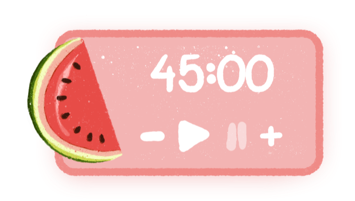

# 🍉 Watermelon Pomodoro

A tiny, hand-drawn pomodoro timer for macOS that floats on top of every app.



## Features

- Floats above all windows, on every desktop, even over full-screen apps
- Drag it anywhere, and it remembers where you left it
- Starts at **00:00**. **– / +** change the time in 15-minute steps, up to 3 hours (even while it's running)
- Shows `MM:SS` under an hour and `HH:MM:SS` from an hour up
- **– ▶ ❚❚ +** sit in one fixed row, so nothing moves around as the time changes
- The watermelon sways while you focus and loses a bite every half hour (popping a few seeds each time). When time's up it shakes, hops and pops seeds 🎉
- Click the watermelon to tuck the widget away: the card retracts to the left and the slice spins into a whole watermelon. Click it again to bring the timer back (it keeps running, and you can drag it either way)
- Right-click for presets, **Reset**, **Open at login**, **Preview celebration** and **Quit**

## Build & run

Requires macOS 14+ and the Swift toolchain (Xcode or the Command Line Tools: `xcode-select --install`).

```bash
./build.sh --install
open /Applications/Watermelon.app
```

`--install` moves the app into **Applications**, so there's only one copy (plain `./build.sh` just builds `build/Watermelon.app` for testing).
The widget has no Dock icon; to bring it back after quitting, open **Watermelon** from Spotlight,
or right-click it and turn on **Open at login** so it starts with your Mac.

## Artwork

All the art is hand-drawn. The layers in `PNGs/` are full 1000 × 560 canvases (the Figma frame).
`scripts/export_art.swift` turns them into the images the app uses in `Resources/Art/`:
`New base.png` becomes the card, `New watermelon.png` and `1 bite` / `2 bites` / `3 bites.png` become the
watermelon's stages, and each digit and control is cropped tight and made a bit bolder.
After changing any drawing, run:

```bash
swift scripts/export_art.swift
./build.sh
```

## Project layout

```
Sources/WatermelonPomodoro/
  main.swift            app entry point (no Dock icon)
  AppDelegate.swift     the floating widget window and the click-through seed overlay
  PomodoroTimer.swift   timer logic
  WidgetView.swift      the widget UI, laid out on the design's 1000 x 560 canvas
  SeedBurst.swift       the popping-seeds animation
  Snapshot.swift        dev helper: renders the widget to a PNG
PNGs/                   source artwork layers
Resources/              Info.plist, app icon, exported art
scripts/                icon + art export scripts
build.sh                builds build/Watermelon.app
```
